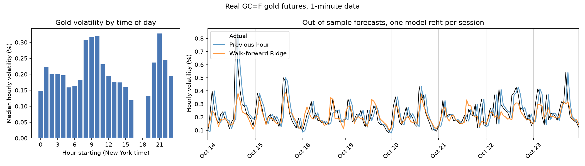
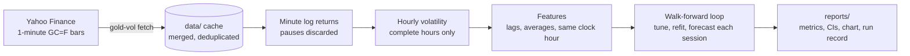

# Gold Volatility Lab

[](https://github.com/chisty38/gold-volatility-lab/actions/workflows/ci.yml)

[](https://github.com/astral-sh/ruff)
[](LICENSE)

Forecasts how much gold futures will move in the next hour, using 1-minute
COMEX prices. The evaluation is walk-forward and leak-free: every forecast
comes from a model that saw only earlier trading sessions. The project's
question: **how much accuracy do you get from very cheap models?**

**Result:** a two-input Ridge regression that knows the time of day cuts
forecast error by **27%** compared with the standard "next hour looks like
the last hour" baseline. It wins in **8 out of 8** trading sessions.



## Results

COMEX gold futures (GC=F) at about $4,000/oz. There are 173 next-hour
forecasts over 8 trading sessions (14–23 October 2026). Before each session,
the model is retuned and refit using only earlier sessions.

| Method | Error (pp) | Error ($/oz) | vs. previous hour | 95% CI (pp) | Sessions won |
| --- | --- | --- | --- | --- | --- |
| Previous hour (persistence) | 0.0712 | $2.85 | — | — | — |
| Average of last 3 hours | 0.0798 | $3.20 | +12% | −0.002 to +0.017 | 1 / 8 |
| Same clock hour, last 5 sessions | 0.0561 | $2.25 | −21% | −0.020 to −0.004 | 7 / 8 |
| **Walk-forward Ridge** | **0.0520** | **$2.09** | **−27%** | **−0.023 to −0.013** | **8 / 8** |

*How to read this:* a typical hour moves gold by about 0.21% (about $8/oz).
Errors are the mean absolute difference between forecast and actual hourly
volatility. Dollar values use the latest price. Confidence intervals come
from a block bootstrap of the change in error against the previous-hour
forecast.

### Findings

- **Time of day dominates.** Gold is about 2.5× more volatile around the US
  open (08:00–11:00 New York) and the Asian open (20:00–22:00) than in the
  late afternoon. The previous-hour forecast always reacts one hour late to
  these regular spikes. In every session, the walk-forward search chose a
  feature set that includes the same clock hour in recent sessions.
- **Most of the gain needs no training.** A plain average of the same clock
  hour gets 21% of the 27%. Ridge adds a further 7%, which is only just
  significant (95% CI −0.009 to −0.0002 pp; wins 6 of 8 sessions).
- **Smoothing hurts.** Averaging the last 3 hours is worse than using only
  the last hour, because it blurs the intraday pattern.
- **It is cheap.** Each chosen model has 2–3 inputs. A full walk-forward run
  fits about 400 models and takes a few seconds on a laptop.

## Quick start

Requires Python 3.14.

```bash
git clone https://github.com/chisty38/gold-volatility-lab.git
cd gold-volatility-lab
python -m venv .venv
source .venv/bin/activate        # Windows: .venv\Scripts\Activate.ps1
pip install -r requirements-dev.txt

gold-vol fetch       # download 1-minute GC=F bars into data/ (extends the cache)
gold-vol evaluate    # walk-forward evaluation; writes reports/
pytest --cov         # 41 offline tests
```

`gold-vol fetch` prints what changed, for example `+30 new bars, 0 revised`.
Yahoo keeps only about 30 days of minute data, so fetching every week or two
builds a longer history over time.

## How it works



| Module | Responsibility |
| --- | --- |
| [`data.py`](src/gold_volatility/data.py) | Download, cache merge, trading-time hourly examples, time-of-day features |
| [`features.py`](src/gold_volatility/features.py) | Past-only lag and rolling-average features, with input validation |
| [`evaluation.py`](src/gold_volatility/evaluation.py) | Walk-forward loop, Ridge search, baselines, bootstrap CIs, reports |
| [`cli.py`](src/gold_volatility/cli.py) | `gold-vol fetch` and `gold-vol evaluate` |

**Forecast target.** At time *t*, forecast the volatility of the clock hour
starting at *t*. Volatility is the standard deviation of that hour's
one-minute log returns, scaled by √60.

**Candidates.** Ridge regression on standardized inputs. It searches 5
feature sets × raw or log target × 5 penalty strengths = 50 settings per
session:

| Feature set | Inputs |
| --- | --- |
| `lags` | last hour, 1 hour ago, 2 hours ago |
| `har_avg` | last hour, mean of last 6 hourly values, mean of last 24 |
| `har_direct` | last hour, realized vol over 6 h and over 24 h of returns |
| `seasonal` | last hour, same clock hour averaged over 5 sessions |
| `har_seasonal` | last hour, 24-hour mean, same clock hour over 5 sessions |

## Keeping the evaluation honest

- **No look-ahead.** Every feature at *t* uses only prices up to *t*. Tests
  change all prices after a cutoff and check that no earlier feature
  changes.
- **Walk-forward, one session at a time.** Each session is forecast by a
  model trained only on earlier sessions. A test deletes later sessions and
  checks that every earlier forecast stays the same.
- **Tuning never sees the test session.** Settings are chosen on the 3 most
  recent past sessions, then refit on all past sessions.
- **Market hours are respected.** Returns that span the daily 17:00–18:00
  New York break or a weekend are discarded. Only fully traded hours count.
- **The tests were tested.** Leaks were planted on purpose: future data in
  the time-of-day feature, and training on the test session. Both made the
  tests fail as intended.
- **Every run is traceable.** `reports/real_run.json` records the SHA-256 of
  the data file, the data window, the settings chosen in each session, and
  library versions.

## Design decisions

| Decision | Why |
| --- | --- |
| Forecast volatility, not price | The direction of the next move is close to unpredictable; its size is not. Volatility forecasts drive stop-losses, position sizing and option pricing. |
| Walk-forward instead of one train/test split | It matches live use and turns one small test set into one test per session. |
| Ridge, not a neural network | The question is accuracy per unit of compute, and with a few hundred hourly examples a linear model is the honest choice. Simple baselines are scored alongside it. |
| MAE with block-bootstrap CIs | Errors within a session are correlated, so resampling whole blocks gives realistic intervals. |
| Standard library HTTP for downloads | No extra dependency for a single JSON endpoint; the download is isolated so tests run offline. |
| Raw data not committed | Yahoo's terms do not allow redistribution. Derived reports are committed so results are visible without running anything. |

## Development

```bash
pre-commit install        # optional: lint and format on every commit
ruff check . && ruff format --check .
pytest --cov              # 100% line coverage, excluding the live download
```

CI runs linting and the test suite on every push and pull request.
Dependabot keeps dependencies and GitHub Actions up to date.

## Limitations

- **Little data so far:** about 4 weeks of minute bars and 8 forecast
  sessions from one month. The gain is consistent across those sessions,
  but that is not enough to show it holds in different market conditions.
- **Data source:** Yahoo Finance is unofficial and free. GC=F is the
  front-month contract, and contract rolls are not adjusted. The first hour
  of each session is not forecast.
- **Compute is not measured yet:** the project asks about accuracy per unit
  of compute, but training and inference costs are not recorded yet.
- **MAE only:** QLIKE, the standard loss for volatility forecasts, is not
  reported yet.

## Roadmap

1. Scheduled data collection (GitHub Actions) so the history grows daily.
2. Publish the next hour's forecast after each update.
3. GARCH(1,1) and full HAR-RV benchmarks with a time-of-day adjustment.
4. Training and inference cost per model, to report accuracy against compute.
5. QLIKE loss and a Diebold–Mariano test next to MAE.

## License

[MIT](LICENSE). Market data © its providers; it is not included in this
repository.
